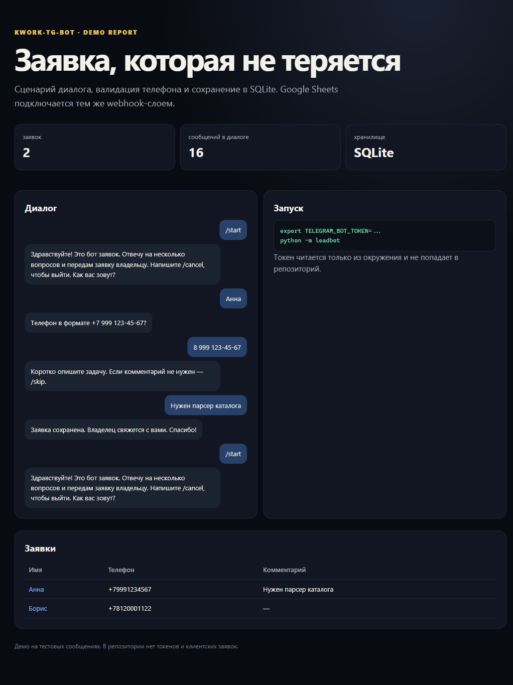

# kwork-tg-bot

Telegram-бот для заявок: короткий диалог, проверка телефона, SQLite и опциональная отправка в Google Sheets через Apps Script webhook.



## Что работает

- `/start` — начать заявку, `/cancel` — отменить;
- шаги: имя → телефон → комментарий;
- нормализация телефона `8 999...` → `+7999...`;
- сохранение в SQLite;
- экспорт заявок в CSV;
- опциональный POST в Google Sheets webhook;
- обработка ошибок webhook без потери заявки.

## Быстрый старт

```bash
export TELEGRAM_BOT_TOKEN="ваш токен"
python -m leadbot
```

Переменные окружения:

| Переменная | Назначение |
|---|---|
| `TELEGRAM_BOT_TOKEN` | токен бота, обязателен |
| `LEAD_DB` | путь к SQLite, по умолчанию `data/leads.sqlite3` |
| `SHEETS_WEBHOOK_URL` | URL Apps Script webhook, опционально |
| `SHEETS_WEBHOOK_SECRET` | секрет webhook, опционально |

## Google Sheets

1. Создайте таблицу.
2. **Расширения → Apps Script**, вставьте `apps-script/Code.gs` и `apps-script/appsscript.json`.
3. В **Project Settings → Script Properties** добавьте `WEBHOOK_SECRET`.
4. **Deploy → New deployment → Web app**, доступ «Anyone».
5. Скопируйте URL в `SHEETS_WEBHOOK_URL`, секрет — в `SHEETS_WEBHOOK_SECRET`.

Без webhook заявки всё равно сохраняются в SQLite и экспортируются в CSV.

## Локальная проверка

```bash
python -m unittest discover -s tests -v
python scripts/build_demo.py
```

Демо прогоняет два диалога через фейковый транспорт, создаёт `demo/leads.csv` и `demo/index.html`. Живой Telegram не требуется.

## Ограничения

- Нет inline-кнопок и вложений; только текст.
- Нет админ-панели и авторизации операторов.
- Нет очереди при недоступности webhook: заявка остаётся в SQLite, но повторная отправка в Sheets не автоматическая.
- Нет CRM, оплат и рассылок.
- Состояние диалога хранится в памяти процесса; после рестарта незавершённая заявка начинается заново.
- Токен и URL webhook не попадают в репозиторий.

## Структура

```text
leadbot/       бот, хранилище, транспорт, webhook
apps-script/   приёмник заявок для Google Sheets
tests/         unittest
scripts/       сборка демо
demo/          транскрипт и CSV
docs/          архитектура
```

## Лицензия

MIT.
